# Database atlas

The implemented PostgreSQL schema: **21 tables · 20 foreign keys · 2 isolated auth schemas**. Blue is patient identity, violet is clinic identity, green is scheduling, orange is booking, and cyan is notifications. Unqualified table names belong to `public`.

Start with the association map, then open a focused ER view to read columns and cardinalities.

| View | Contents |
| --- | --- |
| [Association map](database-overview.mmd) | Every table and foreign key, grouped and colored by domain; arrows run from referenced parent to referencing child and name the child's FK column. |
| [Complete ER diagram](database-complete.mmd) | Every implemented table, column, primary key, foreign key, single-column unique key, and FK cardinality. |
| [Identity ER diagram](database-auth.mmd) | Patient and staff users, sessions, library accounts, verification records, and staff access. |
| [Scheduling and booking ER diagram](database-booking.mmd) | Clinic settings, doctor profile, availability, occupancy, appointments, audit, retry receipts, and identity links. |
| [Notification ER diagram](database-notifications.mmd) | Appointment consent, WhatsApp jobs and attempts, and local email preview jobs. |

## Reading the relationships

- `PK` = primary key, `FK` = foreign key, `UK` = single-column unique constraint. Multiple `PK` columns form one composite key. A `nullable` annotation means the database permits NULL.
- ER endpoint `||` means exactly one, `o|` means zero or one, and `o{` means zero or many. Solid ER lines mean the foreign key is part of the child's primary key; dotted ER lines mean it is not. Both are actual foreign keys.
- `appointments.reservation_id` is nullable and unique: an appointment has at most one occupancy record, and an occupancy record belongs to at most one appointment. Confirmed appointments must have occupancy. Cancellation detaches it, releasing time or retaining an admin block.
- Patient-created bookings require `patient_user_id` and prohibit `created_by_staff_id`; clinic-created bookings require the reverse. Matching an email does not establish patient ownership. `cancelled_by_staff_id` is a separate optional staff relationship.
- `booking_audit.actor_id` and `booking_requests.actor_id` are **logical actor references**, resolved using `actor_kind` to either `patient_auth.user.id` or `staff_auth.user.id`. They have no SQL foreign keys, so the diagrams do not invent physical FK edges for them.
- `verification.identifier` is a lookup identifier, not a user FK. Both verification tables are deliberately shown without a fabricated relationship. Auth `account` tables are library-managed; their presence does not enable password login.

## Constraints beyond the lines

- The clinic and doctor are singletons (`id = 1`). No tenancy, branch, calendar projection, generic outbox, or real-email delivery tables are implemented.
- Reservations share a SQL-only GiST exclusion constraint on half-open UTC ranges `[starts_at, ends_at)`. It prevents overlaps across appointment occupancy and manual blocks; do not remove it from migration `0003`.
- Composite uniqueness: `booking_audit(appointment_id, action)`, `whatsapp_notifications(appointment_id, event)`, and `whatsapp_attempts(notification_id, number)`. The notification event is restricted to `booking_created`, allowing at most one notification job per appointment. Attempts are bounded to three.
- `staff_access` permits one admin through a partial unique index. It enforces PIN ownership and nonnegative failed attempts. Disabling staff access does not delete appointment history.
- Contacts stay encrypted in `appointments.contact_ciphertext`. Booking receipts exclude contacts, and local email jobs hold a clinic/template snapshot rather than patient contacts. Local email is a simulated log after commit.
- Weekly hours use clinic-local minutes; day overrides use local dates. Reservation and appointment times are UTC instants. Appointments retain timezone, duration, and buffer snapshots.

Sources: [Drizzle schemas](../../../src/db/schema), reviewed SQL migrations `0000`–`0009` in [drizzle](../../../drizzle). These views describe the repository schema, not a live database inspection.
